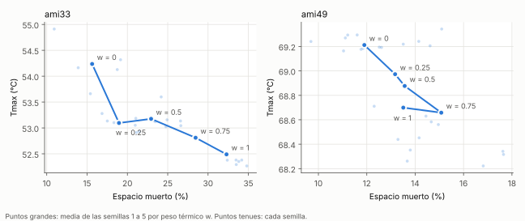

# Resultados en ami33 y ami49 (semana 3)

Corridas de E10 con el código de `main` después del PR #11 (I9 e I10). Semillas 1 a 5, `--alpha 0.5`. Máquina: PC de Eimi, Windows 11, g++ de MinGW con -O2 (build.bat). Los datos crudos están en `results/runs.csv`, que no se sube al repo; este archivo se generó a partir de él.

Cómo leer las tablas:

- **Espacio muerto** = 1 − (área de los bloques / área del chip).
- **Mejor** es el mínimo de esa columna entre las 5 semillas; el mejor espacio muerto y el mejor HPWL pueden venir de semillas distintas.
- **Cabe** cuenta las semillas cuyo resultado entra en el outline fijo del benchmark.
- La búsqueda aleatoria solo minimiza área y no sabe del outline; en `runs.csv` aparece con `outline_weight` 0.

## ami33

| Método | Corridas | Espacio muerto medio | Mejor espacio muerto | HPWL medio | Mejor HPWL | Área media (mm²) | Cabe | Tiempo medio (s) |
|---|---|---|---|---|---|---|---|---|
| Búsqueda aleatoria, 20 000 iteraciones | 5 | 23,27 % | 18,17 % | 146 156 | 130 754 | 1,509 | 0/5 | 0,15 |
| SA, `--outline-weight 5` | 5 | 15,63 % | 10,93 % | 92 976 | 86 240 | 1,372 | 5/5 | 0,59 |
| SA largo, `--outline-weight 5 --cooling 0.98 --moves-per-temp 2000` | 5 | 12,77 % | 9,81 % | 84 265 | 81 447 | 1,326 | 5/5 | 9,77 |

## ami49

| Método | Corridas | Espacio muerto medio | Mejor espacio muerto | HPWL medio | Mejor HPWL | Área media (mm²) | Cabe | Tiempo medio (s) |
|---|---|---|---|---|---|---|---|---|
| Búsqueda aleatoria, 20 000 iteraciones | 5 | 26,11 % | 12,92 % | 2 107 536 | 1 923 551 | 48,411 | 0/5 | 0,27 |
| SA, `--outline-weight 5` | 5 | 11,90 % | 11,04 % | 1 020 173 | 975 681 | 40,237 | 3/5 | 1,67 |
| SA largo, `--outline-weight 5 --cooling 0.98 --moves-per-temp 2000` | 5 | 10,80 % | 9,42 % | 906 049 | 774 067 | 39,747 | 2/5 | 17,06 |

## Resultados publicados

| Benchmark | Trabajo | Área (mm²) | Espacio muerto | Tiempo | De dónde sale |
|---|---|---|---|---|---|
| ami33 | B*-tree, SA [1] | 1,27 | 8,94 % (calculado) | 3417 s | [1], Table 2, columnas "SA B*-tree" |
| ami49 | B*-tree, SA [1] | 36,80 | 3,68 % (calculado) | 4752 s | [1], Table 2, columnas "SA B*-tree" |
| ami33 | Fast-SA [2] | no reportado | no reportado | no reportado | [2] no trae ami33 con optimización de área |
| ami49 | Fast-SA [2] | no reportado | 2,00 % | ver Table II | [2], texto de la Fig. 15 y Table II (p. 646) |

Notas sobre esta tabla:

- [1] optimiza **solo área**, sin outline fijo y sin wirelength; no reporta HPWL. Corrió en una SUN Sparc Ultra-I de 200 MHz, así que sus tiempos no se comparan con los nuestros.
- [1] no indica la unidad de área. Asumimos mm² porque las dimensiones de MCNC están en µm: el área de bloques de ami33 es 1 156 449 µm² = 1,156 mm², coherente con 1,27 mm². El espacio muerto "calculado" sale de esa suposición, no del paper.
- [2] reporta ami49 en la comparación de esquemas de SA (greedy, SA clásico, TimberWolf, Fast-SA), con optimización de área, en un Pentium 4 de 1,6 GHz. El 2,00 % es el valor final que da el texto al comentar la Fig. 15; los tiempos de la Table II hay que copiarlos del PDF, porque no se pudieron extraer del texto.
- Ni [1] ni [2] reportan HPWL para ami33/ami49 sin outline, así que no hay HPWL publicado contra el cual comparar el nuestro.

Referencias:

1. Y.-C. Chang, Y.-W. Chang, G.-M. Wu y S.-W. Wu, "B*-Trees: A New Representation for Non-Slicing Floorplans", en *Proc. ACM/IEEE Design Automation Conference (DAC)*, 2000, pp. 458–463.
2. T.-C. Chen y Y.-W. Chang, "Modern Floorplanning Based on B*-Tree and Fast Simulated Annealing", *IEEE Trans. Computer-Aided Design of Integrated Circuits and Systems*, vol. 25, no. 4, pp. 637–650, abr. 2006.

## Definición de HPWL (Jose, J10)

**Nuestra definición** (`computeHPWL` en `src/Metrics.cpp`). Para cada net se toma la caja más pequeña que encierra todos sus pines y se suma su medio perímetro:

HPWL = Σ por net de (max x − min x) + (max y − min y)

- Cada bloque se conecta en su **centro**: (x + w/2, y + h/2), con el tamaño ya rotado.
- Los **terminales** (pads de I/O) se incluyen como puntos fijos, en las coordenadas que da el archivo `.block` (por ejemplo, `VSS terminal 1410 1610` en ami33).
- Las nets con menos de 2 pines no suman nada.
- Todas las nets pesan 1. La unidad es la de MCNC (µm).

**¿Es igual a la de [2]?** No se puede confirmar. [2] no define HPWL en el texto (no dice si usa el centro de los bloques ni si incluye los pads). Además, como dice la nota de la tabla anterior, ni [1] ni [2] reportan HPWL para ami33/ami49 sin outline. Por eso **no comparamos nuestro HPWL con [2]**, y solo comparamos área y espacio muerto. Si más adelante usamos un HPWL publicado, primero hay que confirmar en ese paper que use la misma definición.

**Control de orden de magnitud** (no es una comparación válida). Dos trabajos recientes reportan para Parquet-4.5 en ami33, con 15 % de espacio libre y relación de aspecto 1, un HPWL de 78 650 [3] y 88 689 [4]. En [3] (Table 7, 30 corridas) Parquet-4.5 cabe en el outline en el 60 % de las corridas. En [4] (Table I, 30 corridas) solo lo logra en el 18 %. Nuestro SA largo da 81 447 (mejor) y 84 265 (medio), así que es el mismo orden de magnitud. [4] también usa el centro de los bloques ("its central coordinate"). [3] no dice si usa el centro, pero sí dice que los pads de I/O quedan fijos en sus coordenadas dadas. No es una comparación justa porque el outline de nuestro archivo ami33 (1326 × 1205) deja 27,6 % de espacio libre, no 15 %.

3. X. Meng, H. Cheng, R. Chen, N. Xu, Y. Chen y W. Zhang, "CSF: Fixed-outline Floorplanning Based on the Conjugate Subgradient Algorithm Assisted by Q-Learning", arXiv:2504.03796v2, 2025, Table 7.
4. H. Li, Z. Yang, H. Pang, N. Xu y Y. Chen, "A double-layer placement algorithm for integrated circuit-based modules on printed circuit board", arXiv:2502.14012, 2025, Table I.

**Figuras finales** (se generan en `results/`, que no se sube):

| Benchmark | Comando | Espacio muerto | Cabe |
|---|---|---|---|
| ami33 | `--sa --outline-weight 5 --cooling 0.98 --moves-per-temp 2000 --seed 4` | 9,81 % | sí |
| ami49 | `--sa --outline-weight 5 --cooling 0.98 --moves-per-temp 2000 --seed 2` | 9,42 % | sí |

Cada corrida deja `<bench>_best.svg` (bloques, contorno del chip en negro y outline fijo en rojo) y `<bench>_convergence.svg` (costo actual y mejor costo por temperatura).

## Frente de Pareto: área contra Tmax (semana 5, E13)

Corridas: `--sa --outline-weight 5 --thermal --thermal-weight W`, pesos 0, 0,25, 0,5, 0,75 y 1, semillas 1 a 5, potencia de J7 (semilla 1, 0,5 a 2 W/mm²). Disipador calibrado contra HotSpot en `docs/VALIDATION.md`: `--heat-sink-h 1.4e5 --package-r 0.20`. Dentro del SA la temperatura se calcula con grilla 16; la Tmax de la tabla es la del mejor floorplan con grilla 32. Datos: `results/pareto.csv` (no se sube), generado con `run_e13.bat`. Tiempos en la PC de Eimi (Windows 11, MinGW g++ -O2).

### ami33

| Peso térmico | Tmax media (°C) | Mejor Tmax (°C) | Espacio muerto medio | HPWL medio | Cabe | Tiempo medio (s) |
|---|---|---|---|---|---|---|
| 0 | 54,24 | 53,66 | 15,63 % | 92 976 | 5/5 | 0,54 |
| 0,25 | 53,10 | 52,91 | 18,96 % | 90 828 | 5/5 | 8,88 |
| 0,5 | 53,18 | 52,93 | 22,94 % | 106 051 | 5/5 | 7,98 |
| 0,75 | 52,81 | 52,35 | 28,46 % | 110 884 | 3/5 | 7,19 |
| 1 | 52,49 | 52,27 | 32,29 % | 104 931 | 1/5 | 8,84 |

### ami49

| Peso térmico | Tmax media (°C) | Mejor Tmax (°C) | Espacio muerto medio | HPWL medio | Cabe | Tiempo medio (s) |
|---|---|---|---|---|---|---|
| 0 | 69,21 | 69,16 | 11,90 % | 1 020 173 | 3/5 | 1,34 |
| 0,25 | 68,97 | 68,56 | 13,17 % | 990 767 | 2/5 | 15,95 |
| 0,5 | 68,88 | 68,45 | 13,57 % | 1 028 905 | 2/5 | 19,35 |
| 0,75 | 68,66 | 68,22 | 15,08 % | 1 043 043 | 1/5 | 18,54 |
| 1 | 68,70 | 68,26 | 13,51 % | 1 046 381 | 1/5 | 15,18 |

Qué muestran los datos:

- **ami33:** el peso 1 baja la Tmax media 1,75 °C (54,24 a 52,49 °C), pero el espacio muerto sube de 15,6 % a 32,3 % y solo 1 de 5 floorplans cabe en el outline. El peso 0,25 ya da 1,14 °C de esa mejora con 3,3 puntos más de espacio muerto, y todos caben.
- **ami49:** la mejor media es 68,66 °C, 0,55 °C menos que sin peso. Las diferencias entre pesos son del mismo tamaño que la dispersión entre semillas (puntos tenues de la figura), y el peso 1 queda por encima del 0,75.
- **Por qué el efecto es pequeño.** Con el paquete de dos partes (I15), toda la potencia pasa por `packageR`, que sube el nodo del paquete a 45 + 0,20 · P: 45,32 °C en ami33 y 55,11 °C en ami49 (calculado con la potencia total de J7). Esa parte no depende de dónde va cada bloque. Lo que la colocación sí cambia es Tmax − T_paquete: en ami33 baja de 8,91 a 7,17 K (20 %), y en ami49 de 14,11 a 13,55 K (4 %).
- **Límites.** Una sola asignación de potencia (semilla 1) y un solo par de valores del disipador. Con potencias más desiguales entre bloques, o con un disipador peor, el término térmico podría pesar más; falta probarlo.
