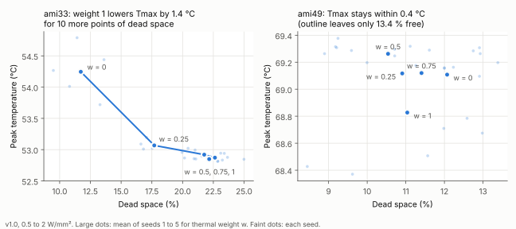
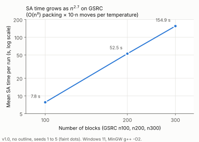

# Resultados (corrido con v1.0)

Todas las tablas de este archivo, salvo la última sección, se corrieron con la etiqueta **`v1.0`** (commit `3a1ca55`): penalización de outline **lineal** (J18, PR #32), disipador calibrado (h = 1,4e5 W/(m²·K), R = 0,20 K/W) e I16. Semillas 1 a 5, `--alpha 0.5`. Máquina: PC de Eimi, Windows 11, g++ de MinGW con -O2 (build.bat). Los datos crudos están en `results/v1/` (no se suben), generados con `run_v1.bat`; este archivo se generó a partir de ellos. Los resultados son deterministas (la misma semilla da el mismo floorplan en cualquier PC); solo los tiempos dependen de la máquina.

Los resultados con la penalización cuadrática de antes de `v1.0` quedan al final, en [Comparación: penalización cuadrática](#comparación-penalización-cuadrática-antes-de-v10).

Cómo leer las tablas:

- **Espacio muerto** = 1 − (área de los bloques / área del chip).
- **Mejor** es el mínimo de esa columna entre las 5 semillas; el mejor espacio muerto y el mejor HPWL pueden venir de semillas distintas.
- **Cabe** cuenta las semillas cuyo resultado entra en el outline fijo del benchmark.
- La búsqueda aleatoria solo minimiza área y no sabe del outline; en los CSV aparece con `outline_weight` 0.

## Área y cables en ami33 y ami49 (E10, corrido con v1.0)

### ami33

| Método | Corridas | Espacio muerto medio | Mejor espacio muerto | HPWL medio | Mejor HPWL | Área media (mm²) | Cabe | Tiempo medio (s) |
|---|---|---|---|---|---|---|---|---|
| Búsqueda aleatoria, 20 000 iteraciones | 5 | 23,27 % | 18,17 % | 146 156 | 130 754 | 1,509 | 0/5 | 0,12 |
| SA, `--outline-weight 5` | 5 | 11,72 % | 9,49 % | 87 244 | 81 822 | 1,310 | 5/5 | 0,56 |
| SA largo, `--outline-weight 5 --cooling 0.98 --moves-per-temp 2000` | 5 | 10,02 % | 7,12 % | 77 910 | 73 341 | 1,287 | 5/5 | 9,80 |

### ami49

| Método | Corridas | Espacio muerto medio | Mejor espacio muerto | HPWL medio | Mejor HPWL | Área media (mm²) | Cabe | Tiempo medio (s) |
|---|---|---|---|---|---|---|---|---|
| Búsqueda aleatoria, 20 000 iteraciones | 5 | 26,11 % | 12,92 % | 2 107 536 | 1 923 551 | 48,411 | 0/5 | 0,26 |
| SA, `--outline-weight 5` | 5 | 12,07 % | 10,71 % | 1 042 650 | 939 057 | 40,314 | 5/5 | 1,66 |
| SA largo, `--outline-weight 5 --cooling 0.98 --moves-per-temp 2000` | 5 | 10,48 % | 8,33 % | 845 151 | 826 189 | 39,605 | 5/5 | 16,89 |

### Penalización cuadrática contra lineal (J18)

Hasta `v1.0` la penalización de outline era (exW/W)² + (exH/H)²: salirse un 2 % costaba 0,0004, así que cerca del borde el SA casi no tenía nada que lo empujara adentro. J18 la cambió a exW/W + exH/H (salirse un 2 % cuesta 0,02). Mismas semillas y mismos comandos; solo cambia la penalización:

| Corrida | Espacio muerto medio (cuadrática → lineal) | HPWL medio (cuadrática → lineal) | Cabe (cuadrática → lineal) |
|---|---|---|---|
| ami33, SA | 15,63 % → 11,72 % | 92 976 → 87 244 | 5/5 → 5/5 |
| ami33, SA largo | 12,77 % → 10,02 % | 84 265 → 77 910 | 5/5 → 5/5 |
| ami49, SA | 11,90 % → 12,07 % | 1 020 173 → 1 042 650 | 3/5 → 5/5 |
| ami49, SA largo | 10,80 % → 10,48 % | 906 049 → 845 151 | 2/5 → 5/5 |
| n100, outline con 15 % libre | 16,42 % → 10,67 % | 288 915 → 256 414 | 0/5 → 5/5 |

- Con la lineal **todas las corridas de SA caben** en el outline, también ami49, cuyo outline deja solo 13,4 % de espacio libre (antes cabían 3/5 con SA y 2/5 con SA largo).
- En ami33 baja a la vez el espacio muerto (15,6 % → 11,7 % con SA) y el HPWL (6,2 % menos): el outline empuja hacia un chip más compacto, que además acorta los cables.
- En ami49 con SA corto el HPWL sube un 2,2 %: es lo que cuesta que las 5 semillas quepan, cuando antes 2 de 5 se salían.

## Resultados publicados

| Benchmark | Trabajo | Área (mm²) | Espacio muerto | Tiempo | De dónde sale |
|---|---|---|---|---|---|
| ami33 | B*-tree, SA [1] | 1,27 | 8,94 % (calculado) | 3417 s | [1], Table 2, columnas "SA B*-tree" |
| ami49 | B*-tree, SA [1] | 36,80 | 3,68 % (calculado) | 4752 s | [1], Table 2, columnas "SA B*-tree" |
| ami33 | Fast-SA [2] | no reportado | no reportado | no reportado | [2] no trae ami33 con optimización de área |
| ami49 | Fast-SA [2] | no reportado | 2,00 % | ver Table II | [2], texto de la Fig. 15 y Table II (p. 646) |

**Nuestro mejor resultado frente a [1].** Con `v1.0`, el mejor SA largo da 1,245 mm² en ami33 (semilla 3, 7,12 % de espacio muerto) y 38,67 mm² en ami49 (semilla 4, 8,33 %), dentro del outline y optimizando también el HPWL. [1] reporta 1,27 y 36,80 mm² optimizando solo área y sin outline. En ami33 quedamos por debajo de [1]; en ami49, 5,1 % por encima. Son mejores semillas, no medias, y [1] no da la dispersión entre corridas, así que no es una comparación de igual a igual.

Notas sobre esta tabla:

- [1] optimiza **solo área**, sin outline fijo y sin wirelength; no reporta HPWL. Corrió en una SUN Sparc Ultra-I de 200 MHz, así que sus tiempos no se comparan con los nuestros.
- [1] no indica la unidad de área. Asumimos mm² porque las dimensiones de MCNC están en µm: el área de bloques de ami33 es 1 156 449 µm² = 1,156 mm², coherente con 1,27 mm². El espacio muerto "calculado" sale de esa suposición, no del paper.
- [2] reporta ami49 en la comparación de esquemas de SA (greedy, SA clásico, TimberWolf, Fast-SA), con optimización de área, en un Pentium 4 de 1,6 GHz. El 2,00 % es el valor final que da el texto al comentar la Fig. 15; los tiempos de la Table II hay que copiarlos del PDF, porque no se pudieron extraer del texto.
- Ni [1] ni [2] reportan HPWL para ami33/ami49 sin outline, así que no hay HPWL publicado contra el cual comparar el nuestro.

Referencias:

1. Y.-C. Chang, Y.-W. Chang, G.-M. Wu y S.-W. Wu, "B*-Trees: A New Representation for Non-Slicing Floorplans", en *Proc. ACM/IEEE Design Automation Conference (DAC)*, 2000, pp. 458–463.
2. T.-C. Chen y Y.-W. Chang, "Modern Floorplanning Based on B*-Tree and Fast Simulated Annealing", *IEEE Trans. Computer-Aided Design of Integrated Circuits and Systems*, vol. 25, no. 4, pp. 637–650, abr. 2006.

## Definición de HPWL (Jose, J10)

**Nuestra definición** (`computeHPWL` en `src/Metrics.cpp`). Para cada net se toma la caja más pequeña que encierra todos sus pines y se suma su medio perímetro:

HPWL = Σ por net de (max x − min x) + (max y − min y)

- Cada bloque se conecta en su **centro**: (x + w/2, y + h/2), con el tamaño ya rotado.
- Los **terminales** (pads de I/O) se incluyen como puntos fijos, en las coordenadas que da el archivo `.block` (por ejemplo, `VSS terminal 1410 1610` en ami33).
- Las nets con menos de 2 pines no suman nada.
- Todas las nets pesan 1. La unidad es la de MCNC (µm).

**¿Es igual a la de [2]?** No se puede confirmar. [2] no define HPWL en el texto (no dice si usa el centro de los bloques ni si incluye los pads). Además, como dice la nota de la tabla anterior, ni [1] ni [2] reportan HPWL para ami33/ami49 sin outline. Por eso **no comparamos nuestro HPWL con [2]**, y solo comparamos área y espacio muerto. Si más adelante usamos un HPWL publicado, primero hay que confirmar en ese paper que use la misma definición.

**Control de orden de magnitud** (no es una comparación válida). Dos trabajos recientes reportan para Parquet-4.5 en ami33, con 15 % de espacio libre y relación de aspecto 1, un HPWL de 78 650 [3] y 88 689 [4]. En [3] (Table 7, 30 corridas) Parquet-4.5 cabe en el outline en el 60 % de las corridas. En [4] (Table I, 30 corridas) solo lo logra en el 18 %. Nuestro SA largo con `v1.0` da 73 341 (mejor) y 77 910 (medio), así que es el mismo orden de magnitud (con la penalización cuadrática, antes de `v1.0`, daba 81 447 y 84 265). [4] también usa el centro de los bloques ("its central coordinate"). [3] no dice si usa el centro, pero sí dice que los pads de I/O quedan fijos en sus coordenadas dadas. No es una comparación justa porque el outline de nuestro archivo ami33 (1326 × 1205) deja 27,6 % de espacio libre, no 15 %.

3. X. Meng, H. Cheng, R. Chen, N. Xu, Y. Chen y W. Zhang, "CSF: Fixed-outline Floorplanning Based on the Conjugate Subgradient Algorithm Assisted by Q-Learning", arXiv:2504.03796v2, 2025, Table 7.
4. H. Li, Z. Yang, H. Pang, N. Xu y Y. Chen, "A double-layer placement algorithm for integrated circuit-based modules on printed circuit board", arXiv:2502.14012, 2025, Table I.

**Figuras finales** (se generan en `results/`, que no se sube; corrido con v1.0):

| Benchmark | Comando | Espacio muerto | Cabe |
|---|---|---|---|
| ami33 | `--sa --outline-weight 5 --cooling 0.98 --moves-per-temp 2000 --seed 3` | 7,12 % | sí |
| ami49 | `--sa --outline-weight 5 --cooling 0.98 --moves-per-temp 2000 --seed 4` | 8,33 % | sí |

Cada corrida deja `<bench>_best.svg` (bloques, contorno del chip en negro y outline fijo en rojo) y `<bench>_convergence.svg` (costo actual y mejor costo por temperatura).

## Frente de Pareto: área contra Tmax (E13, corrido con v1.0)

Corridas: `--sa --outline-weight 5 --thermal --thermal-weight W --heat-sink-h 1.4e5 --package-r 0.20`, pesos 0, 0,25, 0,5, 0,75 y 1, semillas 1 a 5, potencia de J7 (semilla 1, 0,5 a 2 W/mm²). Dentro del SA la temperatura se calcula con grilla 16; la Tmax de la tabla es la del mejor floorplan con grilla 32. Datos: `results/v1/pareto.csv`.

### ami33

| Peso térmico | Tmax media (°C) | Mejor Tmax (°C) | Espacio muerto medio | HPWL medio | Cabe | Tiempo medio (s) |
|---|---|---|---|---|---|---|
| 0 | 54,25 | 53,72 | 11,72 % | 87 244 | 5/5 | 0,63 |
| 0,25 | 53,07 | 53,01 | 17,69 % | 86 970 | 5/5 | 10,82 |
| 0,5 | 52,92 | 52,82 | 21,76 % | 92 363 | 5/5 | 10,96 |
| 0,75 | 52,87 | 52,82 | 22,63 % | 93 558 | 5/5 | 10,97 |
| 1 | 52,85 | 52,81 | 22,16 % | 95 114 | 5/5 | 11,44 |

### ami49

| Peso térmico | Tmax media (°C) | Mejor Tmax (°C) | Espacio muerto medio | HPWL medio | Cabe | Tiempo medio (s) |
|---|---|---|---|---|---|---|
| 0 | 69,11 | 68,71 | 12,07 % | 1 042 650 | 5/5 | 1,67 |
| 0,25 | 69,12 | 68,51 | 10,91 % | 1 001 052 | 4/5 | 7,43 |
| 0,5 | 69,26 | 69,16 | 10,54 % | 1 172 101 | 5/5 | 7,82 |
| 0,75 | 69,12 | 68,67 | 11,41 % | 1 066 927 | 4/5 | 7,80 |
| 1 | 68,83 | 68,37 | 11,04 % | 1 156 855 | 5/5 | 7,82 |

Qué muestran los datos:

- **ami33:** el peso 0,25 baja la Tmax media 1,18 °C (54,25 a 53,07 °C) con 6,0 puntos más de espacio muerto. El peso 1 baja 1,40 °C con 10,4 puntos más. Con la penalización lineal los 25 floorplans con peso caben en el outline (antes, con peso 1, cabía 1 de 5).
- **ami49:** la Tmax media se queda entre 68,83 y 69,26 °C para todos los pesos, una diferencia del tamaño de la dispersión entre semillas (puntos tenues de la figura). Con los pesos 0,25 y 0,5 queda incluso un poco por encima de la del peso 0. El espacio muerto tampoco sube (10,5 a 12,1 %).
- **Por qué ami49 no se mueve.** Su outline deja solo 13,4 % de espacio libre (ami33: 27,6 %). Con la penalización lineal el SA ya no se puede salir del outline para separar los bloques calientes, así que no tiene dónde ganar grados. En ami33 el peso térmico sí usa el espacio libre: el espacio muerto sube hasta unos 22 %, todavía dentro del outline.
- **Parte que depende de la colocación.** Con el paquete de dos partes (I15), toda la potencia pasa por `packageR`, que sube el nodo del paquete a 45 + 0,20 · P: 45,32 °C en ami33 y 55,11 °C en ami49. Lo que la colocación cambia es Tmax − T_paquete: en ami33 baja de 8,92 a 7,53 K con el peso 1 (16 %); en ami49 de 14,00 a 13,72 K en el mejor caso (2 %).
- **Límites.** Una sola asignación de potencia (semilla 1) y un solo par de valores del disipador.

## Sensibilidad a la potencia (E14, corrido con v1.0)

Mismas corridas que E13 pero con densidades de potencia de **0,1 a 10 W/mm²** (semilla de potencia 1), pesos térmicos 0, 0,25 y 0,5, semillas 1 a 5: `--sa --outline-weight 5 --thermal --thermal-weight W --power-min 0.1 --power-max 10 --heat-sink-h 1.4e5 --package-r 0.20`. La potencia total sube a 6,91 W en ami33 y 220,05 W en ami49 (con 0,5 a 2 W/mm² era 1,61 y 50,5 W). Datos: `results/v1/sensitivity.csv`. Con este rango de potencia el modelo subestima la Tmax de ami49 en unos 5 °C frente a HotSpot (J17, `docs/VALIDATION.md`), así que las temperaturas de ami49 sirven para comparar pesos entre sí, no como valores absolutos.

| Benchmark | Peso térmico | Tmax media (°C) | Mejor Tmax (°C) | Espacio muerto medio | HPWL medio | Cabe | Tiempo medio (s) |
|---|---|---|---|---|---|---|---|
| ami33 | 0 | 85,63 | 83,71 | 11,72 % | 87 244 | 5/5 | 0,56 |
| ami33 | 0,25 | 79,92 | 79,51 | 16,91 % | 89 576 | 5/5 | 12,22 |
| ami33 | 0,5 | 79,49 | 79,06 | 20,19 % | 88 900 | 5/5 | 12,19 |
| ami49 | 0 | 158,80 | 156,59 | 12,07 % | 1 042 650 | 5/5 | 1,63 |
| ami49 | 0,25 | 159,15 | 156,94 | 11,40 % | 1 046 944 | 3/5 | 8,69 |
| ami49 | 0,5 | 159,29 | 159,04 | 12,15 % | 1 007 730 | 3/5 | 8,64 |

Qué cambia frente a E13:

- **ami33:** con el peso 0,25 la Tmax media baja 5,72 °C (85,63 a 79,92 °C) con 5,2 puntos más de espacio muerto, y los 5 floorplans caben. En E13 el mismo peso bajaba 1,18 °C. El peso 0,5 casi no agrega: 6,15 °C en total, con 20,2 % de espacio muerto.
- **ami49:** el peso térmico no baja la Tmax: 158,80 °C con peso 0, 159,15 con 0,25 y 159,29 con 0,5, y con peso solo caben 3/5 floorplans. Es el mismo límite que en E13: el outline casi no deja espacio libre.
- **Parte que depende de la colocación.** El nodo del paquete queda en 46,38 °C (ami33) y 89,01 °C (ami49). En ami33 el peso 0,25 baja Tmax − T_paquete de 39,25 a 33,53 K (15 %); en E13, 13 %. En proporción es parecido, pero sobre una subida de 39,3 K en vez de 8,9 K, así que da casi 5 veces más grados con menos área.
- **Validación en HotSpot (J17, Jose; corrido con v1.0).** Con este rango de potencia el modelo ya no queda a 1 °C de HotSpot: el error medio por bloque es 1,9 °C en ami33 y 3,6 °C en ami49, donde la Tmax queda unos 5 °C por debajo (`docs/VALIDATION.md`, sección 6). Para ver si el peso térmico baja la Tmax **de verdad**, se pasaron por HotSpot los floorplans de peso 0 y 0,25, semillas 1 a 5. Tmax por bloque (la del bloque más caliente, en los dos modelos):

  | Benchmark | Tmax nuestra, peso 0 → 0,25 | Tmax HotSpot, peso 0 → 0,25 | Baja en los dos | Misma dirección |
  |---|---|---|---|---|
  | ami33 | 84,96 → 79,39 °C (−5,57) | 82,19 → 78,50 °C (−3,69) | 5/5 | 5/5 |
  | ami49 | 151,60 → 153,02 °C (+1,42) | 156,68 → 160,23 °C (+3,55) | 0/5 | 4/5 |

  En **ami33** la mejora es real: HotSpot también baja la Tmax en las 5 semillas, unos 3,7 °C; nuestro modelo la exagera en unos 1,9 °C. En **ami49** el peso 0,25 no baja la Tmax, y HotSpot confirma que sube (3,6 °C de media, misma dirección en 4 de 5 semillas). Con la penalización cuadrática sí bajaba, pero porque ningún floorplan de peso 0,25 cabía en el outline y el die era más grande (`docs/VALIDATION.md`, secciones 7 y 8).

## Escalabilidad en GSRC (E6, corrido con v1.0)

SA con los valores por defecto (enfriamiento 0,95, 10·n movidas por temperatura), `--alpha 0.5`, semillas 1 a 5. Los archivos de GSRC no traen outline: las tres primeras filas van sin outline, y la última con `--outline-weight 5 --whitespace 0.15` (outline cuadrado de (1,15 · área de bloques)^½ de lado, 15 % de espacio libre, como en la literatura de outline fijo [1]). Datos: `results/v1/gsrc.csv`.

| Benchmark | Bloques | Outline | Espacio muerto medio | Mejor espacio muerto | HPWL medio | Cabe | Tiempo medio (s) |
|---|---|---|---|---|---|---|---|
| n100 | 100 | no | 9,06 % | 8,01 % | 237 142 | — | 7,81 |
| n200 | 200 | no | 9,78 % | 9,02 % | 437 154 | — | 52,47 |
| n300 | 300 | no | 10,68 % | 9,37 % | 625 451 | — | 154,89 |
| n100 | 100 | 15 % libre | 10,67 % | 9,55 % | 256 414 | 5/5 | 8,91 |

- **Tiempo.** De n100 a n300 el tiempo crece 19,8 veces, como n elevado a 2,7. Era de esperar algo cercano a n³: el SA hace 10·n movidas por temperatura y cada empaquetado cuesta O(n²) (cada uno de los n bloques consulta un contorno de hasta n segmentos), porque el contorno O(n) de [2] quedó fuera del alcance (`docs/PLAN.md`). n300 tarda 155 s por corrida.
- **Calidad.** Sin outline el espacio muerto medio sube poco con el tamaño (9,1 %, 9,8 %, 10,7 %), sin cambiar el número de temperaturas. Estas tres filas dan lo mismo que antes de `v1.0` (sin outline la penalización vale 0); solo cambian los tiempos.
- **Outline fijo de 15 %.** Con la penalización lineal n100 cabe en 5/5 semillas, con 10,7 % de espacio muerto medio. Con la cuadrática cabía en 0/5, con 16,4 %: salirse 10 unidades de 454 en ancho y en alto sumaba unos 0,005 al costo (con peso 5), frente a unos 0,3 de área y HPWL, y el SA no tenía nada que lo empujara adentro. Este caso fue el que llevó a J18.

[1] S. N. Adya e I. L. Markov, "Fixed-outline floorplanning: enabling hierarchical design", *IEEE Trans. VLSI Syst.*, vol. 11, no. 6, pp. 1120–1135, dic. 2003.

[2] Y.-C. Chang, Y.-W. Chang, G.-M. Wu y S.-W. Wu, "B*-Trees: A New Representation for Non-Slicing Floorplans", DAC 2000, pp. 458–463.

## Comparación: penalización cuadrática (antes de v1.0)

Mismas corridas con la penalización de outline cuadrática, antes de J18. Se dejan para comparar; los números del informe salen de las secciones de arriba. Tiempos en la PC de Eimi.

### E10 (commit posterior al PR #11)

**ami33**

| Método | Corridas | Espacio muerto medio | Mejor espacio muerto | HPWL medio | Mejor HPWL | Área media (mm²) | Cabe | Tiempo medio (s) |
|---|---|---|---|---|---|---|---|---|
| Búsqueda aleatoria, 20 000 iteraciones | 5 | 23,27 % | 18,17 % | 146 156 | 130 754 | 1,509 | 0/5 | 0,15 |
| SA, `--outline-weight 5` | 5 | 15,63 % | 10,93 % | 92 976 | 86 240 | 1,372 | 5/5 | 0,59 |
| SA largo, `--outline-weight 5 --cooling 0.98 --moves-per-temp 2000` | 5 | 12,77 % | 9,81 % | 84 265 | 81 447 | 1,326 | 5/5 | 9,77 |

**ami49**

| Método | Corridas | Espacio muerto medio | Mejor espacio muerto | HPWL medio | Mejor HPWL | Área media (mm²) | Cabe | Tiempo medio (s) |
|---|---|---|---|---|---|---|---|---|
| Búsqueda aleatoria, 20 000 iteraciones | 5 | 26,11 % | 12,92 % | 2 107 536 | 1 923 551 | 48,411 | 0/5 | 0,27 |
| SA, `--outline-weight 5` | 5 | 11,90 % | 11,04 % | 1 020 173 | 975 681 | 40,237 | 3/5 | 1,67 |
| SA largo, `--outline-weight 5 --cooling 0.98 --moves-per-temp 2000` | 5 | 10,80 % | 9,42 % | 906 049 | 774 067 | 39,747 | 2/5 | 17,06 |

### E13 (commit `1d76c82`, anterior a I16)

**ami33**

| Peso térmico | Tmax media (°C) | Mejor Tmax (°C) | Espacio muerto medio | HPWL medio | Cabe | Tiempo medio (s) |
|---|---|---|---|---|---|---|
| 0 | 54,24 | 53,66 | 15,63 % | 92 976 | 5/5 | 0,54 |
| 0,25 | 53,10 | 52,91 | 18,96 % | 90 828 | 5/5 | 8,88 |
| 0,5 | 53,18 | 52,93 | 22,94 % | 106 051 | 5/5 | 7,98 |
| 0,75 | 52,81 | 52,35 | 28,46 % | 110 884 | 3/5 | 7,19 |
| 1 | 52,49 | 52,27 | 32,29 % | 104 931 | 1/5 | 8,84 |

**ami49**

| Peso térmico | Tmax media (°C) | Mejor Tmax (°C) | Espacio muerto medio | HPWL medio | Cabe | Tiempo medio (s) |
|---|---|---|---|---|---|---|
| 0 | 69,21 | 69,16 | 11,90 % | 1 020 173 | 3/5 | 1,34 |
| 0,25 | 68,97 | 68,56 | 13,17 % | 990 767 | 2/5 | 15,95 |
| 0,5 | 68,88 | 68,45 | 13,57 % | 1 028 905 | 2/5 | 19,35 |
| 0,75 | 68,66 | 68,22 | 15,08 % | 1 043 043 | 1/5 | 18,54 |
| 1 | 68,70 | 68,26 | 13,51 % | 1 046 381 | 1/5 | 15,18 |

### E14 (commit `590fd9f`, anterior a I16)

| Benchmark | Peso térmico | Tmax media (°C) | Mejor Tmax (°C) | Espacio muerto medio | HPWL medio | Cabe | Tiempo medio (s) |
|---|---|---|---|---|---|---|---|
| ami33 | 0 | 85,68 | 82,77 | 15,63 % | 92 976 | 5/5 | 0,49 |
| ami33 | 0,25 | 81,35 | 80,55 | 17,54 % | 93 683 | 5/5 | 13,33 |
| ami33 | 0,5 | 80,80 | 80,37 | 24,00 % | 108 490 | 5/5 | 14,72 |
| ami49 | 0 | 159,41 | 159,09 | 11,90 % | 1 020 173 | 3/5 | 1,42 |
| ami49 | 0,25 | 157,47 | 155,32 | 12,08 % | 998 921 | 2/5 | 24,09 |
| ami49 | 0,5 | 157,69 | 155,71 | 14,21 % | 1 010 857 | 2/5 | 24,71 |

Con la cuadrática el peso 0,25 bajaba la Tmax de ami49 1,93 °C, pero solo cabían 2 de 5 floorplans: los que se salían tenían un die más grande, con más espacio para separar los bloques calientes (`docs/VALIDATION.md`, sección 8).

### E6, n100 con 15 % de espacio libre (commit `e4538cb`)

| Benchmark | Outline | Espacio muerto medio | Mejor espacio muerto | HPWL medio | Cabe | Tiempo medio (s) |
|---|---|---|---|---|---|---|
| n100 | 15 % libre | 16,42 % | 14,61 % | 288 915 | 0/5 | 7,32 |
