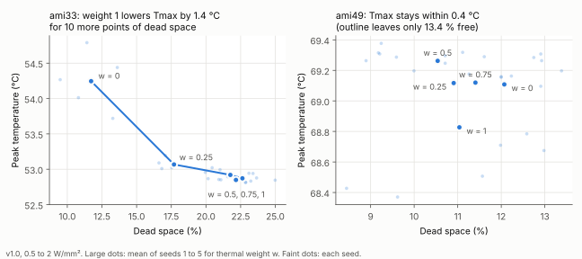
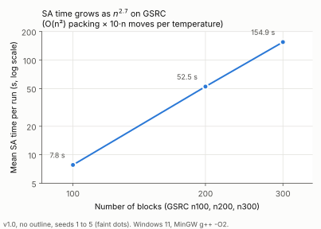

# 6. Results (draft: Eimi 6.1, 6.2, 6.4; Jose 6.3 in `RESULTS_63.md`)

> Draft of the *Results* section of the final report. Every number comes from `docs/RESULTS.md` (runs with the tag `v1.0`) or `docs/VALIDATION.md`. Runs use seeds 1 to 5 and `--alpha 0.5`; the setup is in Section 5. Times are from one Windows 11 PC (MinGW g++ -O2) and only matter relative to each other.

## 6.1 Area and wirelength

Table 6.1 compares SA with the greedy random search of Section 5.3, which tries 20 000 random moves (swap two blocks or rotate one) and keeps a move only if the chip area shrinks; it ignores wirelength and the outline. SA uses the full cost (area, HPWL and outline penalty, `--outline-weight 5`) with the default schedule and with a longer one (cooling 0.98, 2000 moves per temperature).

*Table 6.1. Mean over seeds 1 to 5 (best seed in parentheses). "Fits" counts the seeds whose floorplan is inside the fixed outline.*

| Benchmark | Method | Dead space (%) | HPWL | Fits | Time (s) |
|---|---|---|---|---|---|
| ami33 | Greedy random search, 20 000 moves | 23.27 (18.17) | 146 156 | 0/5 | 0.12 |
| ami33 | SA | 11.72 (9.49) | 87 244 | 5/5 | 0.56 |
| ami33 | SA, long schedule | 10.02 (7.12) | 77 910 | 5/5 | 9.80 |
| ami49 | Greedy random search, 20 000 moves | 26.11 (12.92) | 2 107 536 | 0/5 | 0.26 |
| ami49 | SA | 12.07 (10.71) | 1 042 650 | 5/5 | 1.66 |
| ami49 | SA, long schedule | 10.48 (8.33) | 845 151 | 5/5 | 16.89 |

SA halves the dead space of random search on both benchmarks and cuts HPWL by 40 % on ami33 and by half on ami49, while every SA run fits the outline and no random run does. The long schedule takes 17.5 times longer than the default one on ami33 and 10 times longer on ami49; it buys 1.7 and 1.6 points of dead space and 11 % and 19 % less HPWL.

**Published results.** Chang et al. [B\*-tree] report 1.27 mm² for ami33 and 36.80 mm² for ami49 (Table 2), optimizing area only, without a fixed outline, in 3417 s and 4752 s on a 200 MHz Sun Ultra-I. Our best long-schedule runs give 1.245 mm² on ami33 (seed 3) and 38.67 mm² on ami49 (seed 4, 5.1 % more), inside the outline and with HPWL in the cost. These are best seeds against single published values, and [B\*-tree] gives no spread across runs, so the comparison only shows that our packing and SA are in the expected range. Chen and Chang [Fast-SA] reach 2.00 % dead space on ami49 with Fast-SA and area alone (text of their Fig. 15); our best ami49 run has 8.33 %. Neither paper reports HPWL for these benchmarks, so we do not compare wirelength.

**Outline penalty: quadratic against linear.** Until `v1.0` the outline penalty was (exW/W)² + (exH/H)², where exW and exH are the parts of the chip outside an outline of W × H. A chip 2 % too wide then cost 0.0004, so near the border SA had almost nothing pushing it inside. `v1.0` uses exW/W + exH/H (2 % costs 0.02). Table 6.2 repeats the same runs with both penalties.

*Table 6.2. Same seeds and commands; only the outline penalty changes. Mean over seeds 1 to 5.*

| Run | Dead space (%), quadratic → linear | HPWL, quadratic → linear | Fits, quadratic → linear |
|---|---|---|---|
| ami33, SA | 15.63 → 11.72 | 92 976 → 87 244 | 5/5 → 5/5 |
| ami33, SA long | 12.77 → 10.02 | 84 265 → 77 910 | 5/5 → 5/5 |
| ami49, SA | 11.90 → 12.07 | 1 020 173 → 1 042 650 | 3/5 → 5/5 |
| ami49, SA long | 10.80 → 10.48 | 906 049 → 845 151 | 2/5 → 5/5 |
| n100, outline with 15 % free space | 16.42 → 10.67 | 288 915 → 256 414 | 0/5 → 5/5 |

With the linear penalty every SA run fits. The largest change is on the tight outlines: ami49 (13.4 % free space) goes from 3/5 and 2/5 to 5/5, and GSRC n100 with 15 % free space from 0/5 to 5/5. On ami33, whose outline leaves 27.6 % free space, all runs already fitted, but the linear penalty still lowers dead space by 3.9 points and HPWL by 6 % with the default schedule: the outline keeps pulling the chip together until the last unit. The only cost is on ami49 with the default schedule, where HPWL rises by 2.2 % now that the two seeds that used to fall outside the outline have to fit.

## 6.2 Area–temperature trade-off

To measure what each degree costs, we ran SA with thermal weights w = 0, 0.25, 0.5, 0.75 and 1 on both benchmarks, with synthetic power of 0.5 to 2 W/mm² (power seed 1: 1.61 W on ami33 and 50.5 W on ami49) and the calibrated package (h = 1.4·10⁵ W/(m²·K), R = 0.20 K/W). Inside SA the temperature uses a 16 × 16 grid; Table 6.3 reports the peak temperature of the final floorplan on a 32 × 32 grid.

*Table 6.3. Thermal weight sweep, mean over seeds 1 to 5.*

| Benchmark | w | Tmax (°C) | Dead space (%) | HPWL | Fits | Time (s) |
|---|---|---|---|---|---|---|
| ami33 | 0 | 54.25 | 11.72 | 87 244 | 5/5 | 0.63 |
| ami33 | 0.25 | 53.07 | 17.69 | 86 970 | 5/5 | 10.82 |
| ami33 | 0.5 | 52.92 | 21.76 | 92 363 | 5/5 | 10.96 |
| ami33 | 0.75 | 52.87 | 22.63 | 93 558 | 5/5 | 10.97 |
| ami33 | 1 | 52.85 | 22.16 | 95 114 | 5/5 | 11.44 |
| ami49 | 0 | 69.11 | 12.07 | 1 042 650 | 5/5 | 1.67 |
| ami49 | 0.25 | 69.12 | 10.91 | 1 001 052 | 4/5 | 7.43 |
| ami49 | 0.5 | 69.26 | 10.54 | 1 172 101 | 5/5 | 7.82 |
| ami49 | 0.75 | 69.12 | 11.41 | 1 066 927 | 4/5 | 7.80 |
| ami49 | 1 | 68.83 | 11.04 | 1 156 855 | 5/5 | 7.82 |

*Figure 5. Area against peak temperature. On ami33 the thermal weight trades dead space for a lower Tmax; on ami49 the means do not follow the weight.*

**ami33.** The first step does most of the work: w = 0.25 lowers Tmax by 1.18 °C for 6.0 more points of dead space, and w = 1 by 1.40 °C for 10.4 points, so 84 % of the gain comes at a quarter of the weight. All 25 runs with a thermal weight still fit the outline. The spread between seeds also shrinks, from 0.41 °C at w = 0 to 0.03 °C at w = 1. Evaluating the temperature at every move makes a run about 17 times slower (0.63 s to 10.8–11.4 s).

**ami49.** Tmax stays between 68.83 and 69.26 °C for every weight, a range no larger than the spread between seeds (up to 0.44 °C), and w = 0.25 and 0.5 are even slightly hotter than w = 0. Dead space does not grow either (10.5 to 12.1 %). The outline of ami49 leaves 13.4 % free space, half that of ami33, and with the linear penalty SA can no longer leave the outline to move the hot blocks apart. With the old quadratic penalty, the weight did lower Tmax on ami49, but only because most of those floorplans did not fit and had a larger die (`docs/RESULTS.md`, last section).

**Package and placement.** In our model all the power crosses the lumped resistance R, which puts the package node at T_pkg = 45 °C + 0.20 K/W · P: 45.32 °C on ami33 and 55.11 °C on ami49. The floorplan cannot change that node; it can only change Tmax − T_pkg. The best weight lowers that part by 16 % on ami33 (8.92 to 7.53 K) and by 2 % on ami49 (14.00 to 13.72 K). With one power assignment and one package these are small effects; Section 6.3 shows what happens with much more uneven power.

## 6.3 Power sensitivity

Written by Jose in `docs/report/RESULTS_63.md` (E14 and J17); Ismael merges it here. Its table becomes Table 6.4, so the GSRC table below is Table 6.5.

## 6.4 Scalability

GSRC n100, n200 and n300 have no fixed outline, so the first three rows of Table 6.5 run SA without one. The last row gives n100 a square outline with 15 % free space (`--whitespace 0.15`), as in the fixed-outline literature [Adya].

*Table 6.5. SA with the default schedule (cooling 0.95, 10·n moves per temperature), mean over seeds 1 to 5 (best seed in parentheses).*

| Benchmark | Blocks | Outline | Dead space (%) | HPWL | Fits | Time (s) |
|---|---|---|---|---|---|---|
| n100 | 100 | none | 9.06 (8.01) | 237 142 | – | 7.81 |
| n200 | 200 | none | 9.78 (9.02) | 437 154 | – | 52.47 |
| n300 | 300 | none | 10.68 (9.37) | 625 451 | – | 154.89 |
| n100 | 100 | 15 % free | 10.67 (9.55) | 256 414 | 5/5 | 8.91 |

*Figure 7. Mean SA time per run on GSRC, log–log scale.*

From n100 to n300 the time grows 19.8 times, which fits n^2.7. We expected close to n³: SA makes 10·n moves per temperature, and each packing is O(n²) because every block queries a contour of up to n segments. The O(n) contour of [B\*-tree] was left out of the scope (Section 3), and it is the first thing to add if larger designs matter. Quality holds with size: mean dead space goes from 9.1 % to 10.7 % with the same number of temperatures. With a 15 % outline, n100 fits in 5 of 5 seeds at 10.7 % dead space; with the quadratic penalty it fitted in none (Table 6.2).

## References used in this section (to merge into the report list)

- [B\*-tree] Y.-C. Chang, Y.-W. Chang, G.-M. Wu and S.-W. Wu, "B\*-Trees: A new representation for non-slicing floorplans," in *Proc. 37th DAC*, 2000, pp. 458–463, doi:10.1109/DAC.2000.855354.
- [Fast-SA] T.-C. Chen and Y.-W. Chang, "Modern floorplanning based on B\*-tree and fast simulated annealing," *IEEE Trans. Computer-Aided Design*, vol. 25, no. 4, pp. 637–650, Apr. 2006.
- [Adya] S. N. Adya and I. L. Markov, "Fixed-outline floorplanning: enabling hierarchical design," *IEEE Trans. VLSI Syst.*, vol. 11, no. 6, pp. 1120–1135, Dec. 2003, doi:10.1109/TVLSI.2003.817546.
